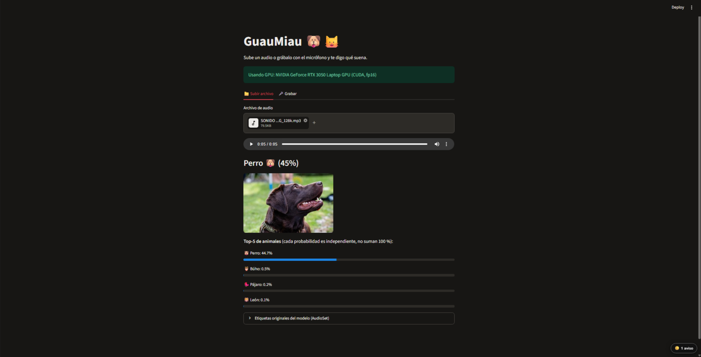
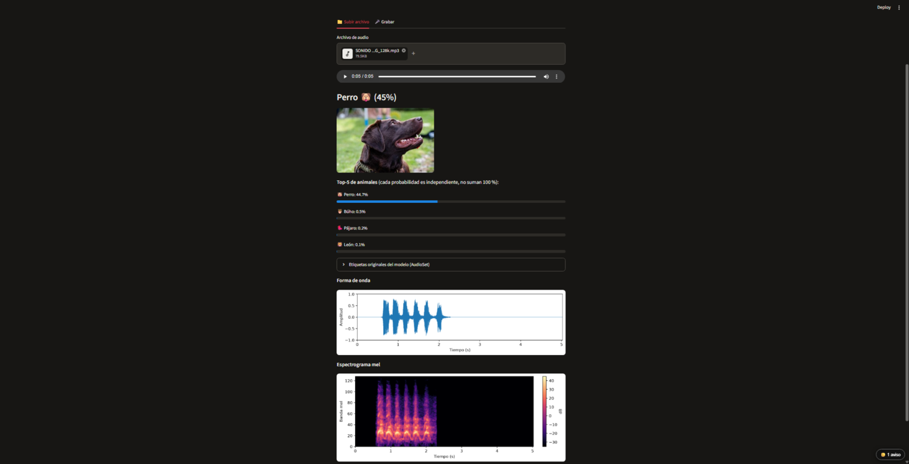
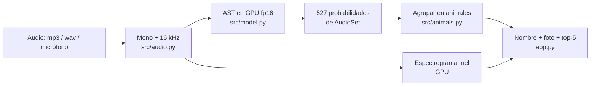
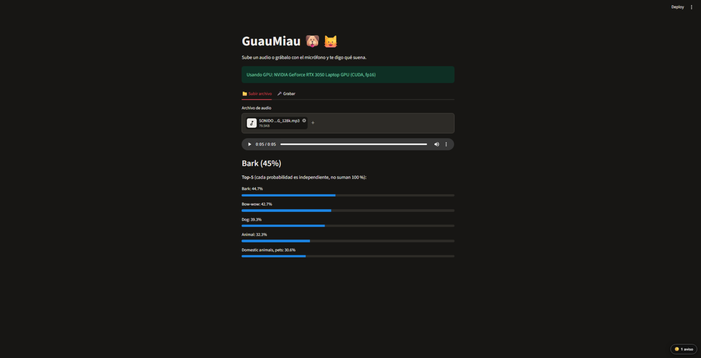
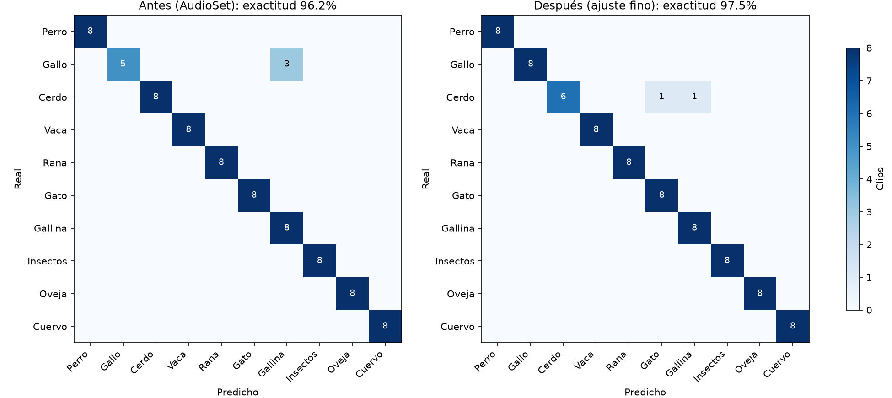
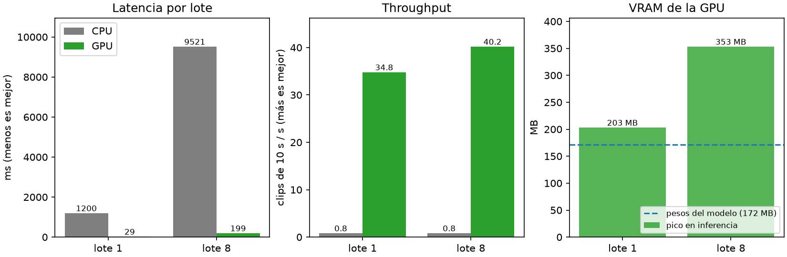

# GuauMiau 🐶🐱

**Detector de sonidos de animales acelerado con CUDA.** Sube un audio o grábalo con el micrófono y GuauMiau te dice qué animal suena, con su foto, la confianza, la forma de onda y el espectrograma.




## ¿Qué problema resuelve?

Reconocer un animal por su sonido sirve para **monitoreo de fauna**, **apoyo educativo** y **accesibilidad** (identificar sonidos del entorno) sin necesitar a un experto. GuauMiau automatiza esa tarea: entra un audio, sale el animal.

## ¿Qué hace?

- 🎧 Recibe un archivo `.wav` / `.mp3` o una grabación del micrófono.
- 🐾 Identifica el animal y lo muestra **en español, con su foto**: perro, gato, gallo, gallina, vaca, cerdo, oveja, cabra, caballo, pato, pájaro, cuervo, búho, rana, insectos, león y ballena.
- 📊 Muestra el **top-5 de animales** con su probabilidad.
- 🌊 Dibuja la **forma de onda** y el **espectrograma mel** del audio (lo que el modelo "ve").
- ⏱️ En audios largos, arma una **línea de tiempo**: qué animal suena en cada ventana de 5 s.
- ⚡ Incluye un **panel de benchmark CPU vs GPU** dentro de la app.
- 💻 Funciona sin GPU (usa la CPU) y avisa en pantalla qué dispositivo está usando.



## Cómo funciona



AudioSet tiene varias etiquetas para un mismo animal (un ladrido puntúa alto en `Bark` y más bajo en `Dog`). `src/animals.py` las agrupa por animal y se queda con la probabilidad más alta. Sin ese paso la app respondía `Bark (45 %)`; con él responde `Perro 🐶 (45 %)`.

<details>
<summary>Antes del mapeo a animales</summary>



</details>

## Modelo de Hugging Face

| | |
|---|---|
| **Modelo** | [`MIT/ast-finetuned-audioset-10-10-0.4593`](https://huggingface.co/MIT/ast-finetuned-audioset-10-10-0.4593) (Audio Spectrogram Transformer) |
| **Emisor** | MIT. Paper de Gong, Chung y Glass (Interspeech 2021, [arXiv:2104.01778](https://arxiv.org/abs/2104.01778)). La *model card* la escribió el equipo de Hugging Face |
| **Parámetros** | 86,6 millones (86 594 063) |
| **Licencia** | BSD-3-Clause |
| **Entrenado con** | AudioSet: 527 clases de sonidos, multietiqueta |
| **Entrada** | Audio mono a 16 kHz; se recorta o rellena a ~10 s |

**Por qué lo elegimos:** es un Transformer de visión aplicado al espectrograma del audio, ya entrenado con AudioSet, que incluye perro, gato, gallo, vaca, cerdo, rana, león y más. Funciona desde el primer día, sin entrenar. Además sus operaciones (atención = multiplicación de matrices) se paralelizan muy bien en una GPU.

**Restricciones:** solo distingue las 527 clases de AudioSet; analiza ~10 s por vez (por eso la línea de tiempo); las probabilidades son independientes y no suman 100 %; AudioSet viene de YouTube y trae ruido en las etiquetas. Más detalle en [docs/model_card.md](docs/model_card.md).

**Ajustes que hicimos:** el mapeo a animales en español (`src/animals.py`), el procesamiento por ventanas para audios largos y un ajuste fino con ESC-50 (siguiente sección).

## Ajuste fino con ESC-50

Reentrenamos AST con los **10 animales de [ESC-50](https://github.com/karolpiczak/ESC-50)** (perro, gallo, cerdo, vaca, rana, gato, gallina, insectos, oveja y cuervo: 400 clips de 5 s). Se cambió la cabeza de 527 salidas por una de 10 y se entrenó en la GPU con precisión mixta (AMP fp16). Se entrena con los folds 1 a 4 y se valida con el fold 5 (80 clips).



| Modelo | Exactitud (80 clips) |
|---|---|
| Antes (AST de AudioSet, agrupado por animal) | 96,2 % (77/80) |
| Después (ajuste fino) | 97,5 % (78/80) |

**Cómo leerlo con honestidad:** la diferencia es de **un solo clip**, demasiado poco para afirmar que un modelo es mejor. Lo que sí se ve en la matriz: antes, 3 de 8 gallos se confundían con gallina (la etiqueta `Chicken, rooster` de AudioSet mezcla los dos); el modelo ajustado acierta los 8 gallos pero falla 2 cerdos. Además, el fold 5 se usó también para elegir el mejor checkpoint, así que la cifra es algo optimista. Resultados completos en [docs/resultados/metricas.json](docs/resultados/metricas.json).

## CUDA en GuauMiau

**CUDA** es la plataforma de NVIDIA para ejecutar cálculo general en la GPU. Una GPU tiene miles de núcleos pequeños: CUDA organiza el trabajo en **hilos**, los agrupa en **bloques** y lanza funciones llamadas **kernels** que corren en todos a la vez. Un Transformer como AST es, en el fondo, una cadena de multiplicaciones de matrices (la atención y las capas lineales), justo lo que la GPU reparte mejor. Con fp16 se usan además los *tensor cores*, unidades hechas para multiplicar matrices en media precisión.

**Dónde se usa dentro de la app:**

| Dónde | Qué hace | Archivo |
|---|---|---|
| Inferencia | El modelo corre en `cuda` con **fp16**; si no hay GPU cae a CPU con fp32 | `src/model.py` |
| Espectrograma | La FFT y los filtros mel se calculan en GPU con `torchaudio` | `src/audio.py` |
| Línea de tiempo | Las ventanas de un audio largo se apilan y se procesan **por lotes** en una sola pasada | `src/timeline.py` |
| Entrenamiento | **AMP** (fp16 + `GradScaler`), `pin_memory`, lote 4 con acumulación x4 para caber en 4 GB | `train/train.py` |
| Benchmark | Mide latencia, throughput y VRAM, en CPU y en GPU | `src/cuda_bench.py` |

### Benchmark CPU vs GPU

Medido en una **NVIDIA GeForce RTX 3050 Laptop (4 GB)** contra la CPU de la misma máquina, con clips de 10 s, calentamiento previo y `torch.cuda.synchronize()` antes de parar el cronómetro (CUDA es asíncrono; sin eso se mediría solo el tiempo de encolar).



| Dispositivo | Lote | Latencia | Clips/s | VRAM pico |
|---|---|---|---|---|
| CPU fp32 | 1 | 1200 ms | 0,83 | — |
| CPU fp32 | 8 | 9521 ms | 0,84 | — |
| GPU fp16 | 1 | 28,7 ms | 34,8 | 203 MB |
| GPU fp16 | 8 | 199 ms | 40,2 | 353 MB |

La GPU es **41,8 veces más rápida** con lote 1 y **47,9 veces** con lote 8. Fíjate en el throughput: la CPU no mejora al agrandar el lote (0,83 → 0,84 clips/s), mientras que la GPU sí (34,8 → 40,2), porque tiene núcleos libres para procesar más a la vez. Los pesos del modelo ocupan 172 MB de VRAM.

## Instalación y uso

Requisitos: [uv](https://docs.astral.sh/uv/), Python 3.12 (uv lo gestiona) y, para usar la GPU, una tarjeta NVIDIA con un driver compatible con **CUDA 12.8 o superior** (`nvidia-smi` muestra la versión). Sin GPU la app funciona en CPU, solo que más lenta.

> ⚠️ PyTorch con CUDA pesa varios GB: la primera instalación necesita entre 8 y 10 GB libres. El modelo (~350 MB) se descarga solo la primera vez que se usa y queda en la caché de Hugging Face.

```bash
git clone git@github.com:gminos/GuauMiau.git
cd GuauMiau
uv sync
uv run python -c "import torch; print(torch.cuda.is_available())"   # True si hay GPU
uv run streamlit run app.py
```

Otros comandos:

```bash
uv run python train/train.py              # ajuste fino con ESC-50 (descarga ~600 MB de datos)
uv run python train/evaluate.py           # matriz de confusión antes / después
uv run python -m src.cuda_bench           # benchmark CPU vs GPU
```

Los datos (`data/`) y los pesos entrenados (`checkpoints/`) **no se suben** al repositorio.

## Estructura del proyecto

```
GuauMiau/
├── app.py               # Interfaz Streamlit
├── src/
│   ├── audio.py         # carga, mono, remuestreo a 16 kHz y espectrograma mel
│   ├── model.py         # AST, selección de dispositivo e inferencia (por lotes)
│   ├── animals.py       # etiquetas de AudioSet → animal en español + foto
│   ├── timeline.py      # línea de tiempo para audios largos
│   ├── plots.py         # gráficos de matplotlib
│   └── cuda_bench.py    # benchmark CPU vs GPU
├── train/
│   ├── train.py         # ajuste fino con ESC-50
│   └── evaluate.py      # precisión y matriz de confusión
├── assets/animals/      # fotos de animales (+ CREDITS.md con las licencias)
├── docs/                # ficha del modelo, resultados y capturas
├── pyproject.toml       # dependencias (uv)
└── uv.lock
```

## Equipo

| Integrante | Aportes |
|---|---|
| [@gminos](https://github.com/gminos) | Interfaz Streamlit, mapeo a animales y fotos, gráficos de onda y espectrograma, README |
| [@DL-VI](https://github.com/DL-VI) | Carga y preprocesado de audio, modelo AST e inferencia, línea de tiempo por lotes |
| [@LuisVanegas2](https://github.com/LuisVanegas2) | Configuración de PyTorch con CUDA, ajuste fino con ESC-50, evaluación y benchmark CPU vs GPU |

El trabajo se repartió con [Issues](https://github.com/gminos/GuauMiau/issues) y se integró con [Pull Requests](https://github.com/gminos/GuauMiau/pulls).

## Licencias y créditos

- **Código:** [MIT](LICENSE).
- **Modelo AST:** BSD-3-Clause, de MIT (Gong et al.). No se usa su nombre para promocionar el proyecto.
- **ESC-50** (K. J. Piczak, 2015): **CC BY-NC 3.0**, solo uso no comercial; cada clip conserva su licencia individual (CC0, CC BY...). Por eso este proyecto es **solo educativo**.
- **Fotos de animales:** Wikimedia Commons, con su autor y licencia en [assets/animals/CREDITS.md](assets/animals/CREDITS.md).
